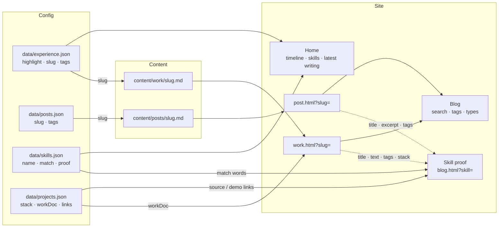

Everything on this site is driven by a handful of config files. Nothing is wired by hand: add an entry in the right place, use the same **slug**, **tags** and **words**, and the site connects it everywhere it belongs.

This post walks through one complete example — **one experience bullet, one blog post and one skill** — using real entries from this site, and shows exactly how they find each other.

## The map



There are only three kinds of glue:

| Glue | What it connects |
| --- | --- |
| **Slug** | a config entry ↔ its Markdown file ↔ its page URL |
| **Tags** | documents ↔ tag filters on the Blog |
| **Words** (a skill's `match` list) | a skill ↔ every document that mentions it |

## 1. An experience bullet

Every bullet in `data/experience.json` is a small config object. This is the real one behind the Saga orchestrator line on the home page:

```jsonc
// data/experience.json → CaratLane → "Software Development Engineer II" → highlights
{
  "slug": "saga-orchestrator",
  "title": "A reusable Saga orchestrator",
  "text": "Built a reusable **Saga Orchestrator** for multi-step async workflows with rollback, …",
  "tags": ["saga-pattern", "microservices", "system-design"],
  "draft": true
}
```

What each field does:

- `text` is the bullet on the home page timeline. `**bold**` works.
- `slug` makes the bullet clickable → `work.html?slug=saga-orchestrator`, and names its write-up file: **`content/work/saga-orchestrator.md`**.
- `title` is the write-up's heading and its title in Blog lists and search.
- `tags` feed the Blog's tag filters and count towards skill proof.
- The **role** the bullet sits under adds two more things automatically: its `stack` (Kafka, Microservices, Saga pattern, React.js…) and its context line "CaratLane — A Tata Product · Software Development Engineer II".
- `draft: true` keeps the full write-up private: visitors see the bullet and a "write-up in progress" card. Set it to `false` when the story is ready — it then also appears on the Blog under **Work**.

> [!TIP]
> To add a new bullet, add an object like this to the right role, then create `content/work/<slug>.md`. The template inside any existing stub shows the outline: context, problem, constraints, approach, results.

## 2. A blog post

A post is one entry in `data/posts.json` plus one Markdown file with the same slug. One command creates both:

```bash
node scripts/new-post.mjs "What the Saga pattern actually buys you" --tags saga-pattern,microservices,kafka
```

```jsonc
// data/posts.json (newest first)
{
  "slug": "what-the-saga-pattern-buys-you",
  "title": "What the Saga pattern actually buys you",
  "date": "2026-11-24",
  "excerpt": "Where Sagas shine, what they cost, and when not to use them.",
  "tags": ["saga-pattern", "microservices", "kafka"],
  "draft": true
}
```

Once `draft` is `false`, the post shows up — with no other changes — in:

- **Home → Latest writing** (the three newest documents)
- **Blog** list, full-text search and the `#saga-pattern`, `#microservices`, `#kafka` tag filters
- **Previous / next** links on neighbouring posts
- **Skill proof** pages whose words it mentions (next section)

Link it to the experience it's about with a normal Markdown link inside the post:

```markdown
I built one of these at CaratLane — the full story is in
[the Saga orchestrator write-up](work.html?slug=saga-orchestrator).
```

## 3. A skill

Skills live in `data/skills.json`. Here is the real "Saga Pattern" entry, with one proof link added:

```jsonc
// data/skills.json → "Concepts" → items
{
  "name": "Saga Pattern",
  "match": ["saga", "saga-pattern"],
  "proof": [
    { "label": "Saga orchestrator demo", "url": "https://github.com/…", "type": "github" }
  ]
}
```

- `name` becomes a tag in **Home → Skills & tools**, linking to `blog.html?skill=saga-pattern`.
- `match` is the list of **whole words** that count as "uses this skill". The site looks for them in every document's title, excerpt/text, tags, context and stack. Without `match`, the skill's own name is used.
- `proof` holds hand-picked evidence: GitHub repos, live demos, certificates, talks (`type`: `github`, `demo`, `article`, `certificate`, `video`, `link`).

The skill page then **collects everything automatically**:

1. the `proof` links above;
2. the source / demo links of any project whose stack or summary mentions a match word;
3. every published document that mentions a match word — here, the Saga orchestrator write-up (its title says *Saga*, its tags say *saga-pattern*) **and** the new blog post (tagged *saga-pattern*).

The small number on the skill tag on the home page is that total.

## How it all lines up

| You add… | It appears on… | Connected by |
| --- | --- | --- |
| a bullet in `experience.json` | home timeline, its own page, Blog → Work (when not a draft) | `slug` → `content/work/<slug>.md` |
| a post in `posts.json` | home latest writing, Blog, search, tags, prev/next | `slug` → `content/posts/<slug>.md` |
| a skill in `skills.json` | home skills, its proof page | `match` words found in documents |
| tags on a post or bullet | Blog tag filters, skill proof | the same tag string |
| `stack` on a role or project | role/project tags, skill proof | the same tech name |
| `workDoc` on a project | project card links to the write-up | the bullet's `slug` |

## Rules that keep it working

- **Same spelling everywhere.** `saga-pattern` in tags and `saga-pattern` in a skill's `match` — tags are lowercase-kebab-case.
- **Slug = file name.** `saga-orchestrator` ↔ `content/work/saga-orchestrator.md`.
- **Drafts and samples stay local.** They show on `localhost` and never on the live site until you flip the flag.
- **Check before publishing:** `node scripts/check-content.mjs` catches missing files, bad slugs and broken image paths, and lists what's still draft.

> [!NOTE]
> Every link above is generated from config — there is no list of links to maintain. Add the entry, keep the words consistent, and the site does the stitching.
