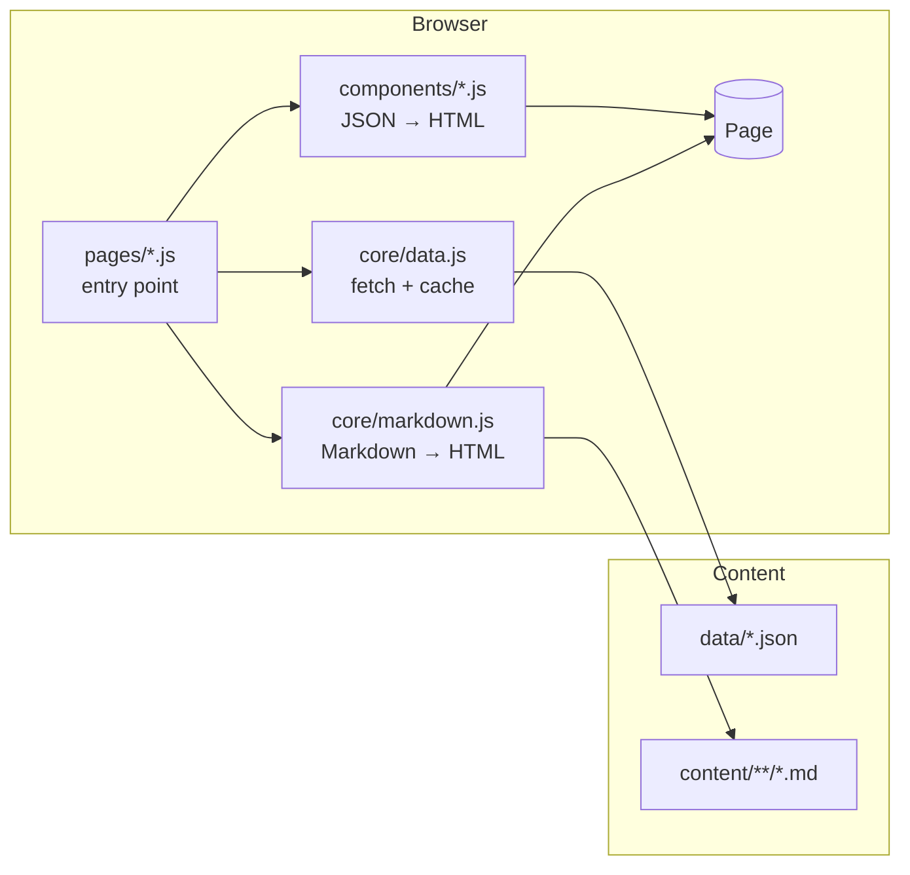
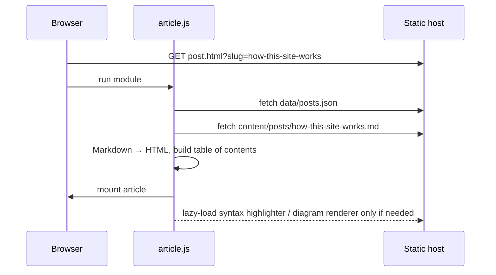

## Why no framework

My old portfolio was one 1,600-line HTML file with the content, styles and scripts all mixed together. Adding a project meant scrolling through CSS to find a JavaScript object. I wanted the opposite: **content I can edit without touching code**, and code I can read in an afternoon.

So this site has no framework and no build step. It's plain HTML, CSS and JavaScript modules, served as static files. Content lives in two places:

- **JSON** for structured data — profile, experience, projects, skills, the blog index
- **Markdown** for anything long-form — posts, work write-ups, case studies

## How a page gets built

Every page is an almost-empty HTML shell. A small JavaScript module loads the JSON it needs, turns it into HTML, and mounts it.



Opening a post looks like this:



## Safe HTML without a framework

The one thing a framework gives you for free is escaping. Here it's a tiny tagged template: every value is HTML-escaped unless it was itself produced by `html`.

```js
export function html(strings, ...values) {
  let out = strings[0];
  for (let i = 0; i < values.length; i++) out += toHTML(values[i]) + strings[i + 1];
  return new SafeHTML(out);
}

// Components are just functions that return html``
const Tag = (name) => html`<li class="tag">${name}</li>`;
```

A component returns `null` when it has nothing to show, so empty sections simply disappear — no "coming soon" placeholders on the live site.

## One library for everything readable

Articles, the write-up behind each résumé bullet, and project case studies all feed one list. The Blog page searches and filters that list, so every kind of document is discoverable from one place.

| Type | Index | Body |
| --- | --- | --- |
| Article | `data/posts.json` | `content/posts/<slug>.md` |
| Work write-up | `data/experience.json` | `content/work/<slug>.md` |
| Case study | `data/projects.json` | `content/projects/<slug>.md` |

## Drafts and samples

Anything marked `"draft": true` or `"sample": true` is visible when I run the site locally, and hidden on the live site. I can write in the open, preview exactly how it will look, and publish by flipping one flag.

> [!TIP]
> Adding a post is one command: `node scripts/new-post.mjs "Title"` creates the Markdown file and the index entry.

## Trade-offs

- **SEO:** pages render in the browser. Search engines handle this, but a static-site generator would be better if traffic ever matters — and the `data/` and `content/` folders would move over unchanged.
- **Search:** in-memory, fine for hundreds of posts.
- **No build** means no bundling — but the pages are small, and heavy pieces like the diagram renderer only load when a page needs them.
