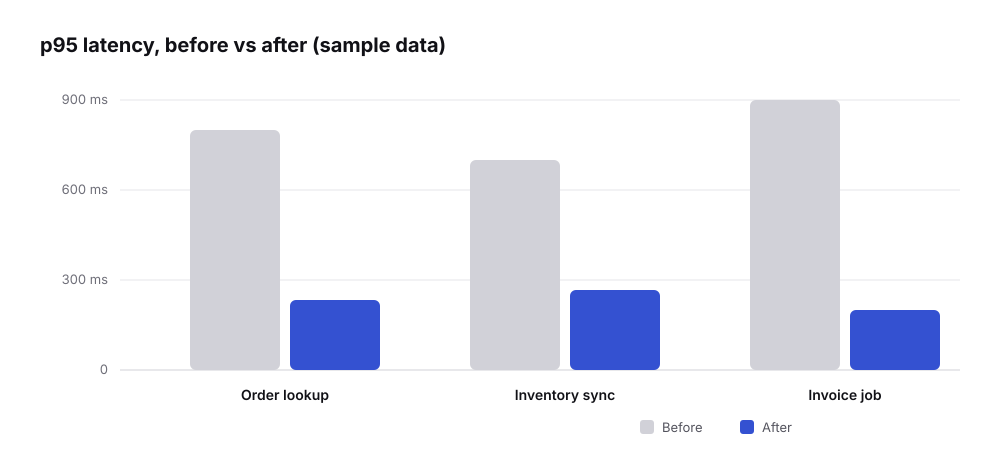

> [!NOTE]
> **Sample article** — placeholder content to show how a short post looks.

## What lag measures

Consumer lag is the distance between the **latest offset** in a partition and the **committed offset** of your consumer group. It tells you how far behind you are — not why.

```bash
kafka-consumer-groups --bootstrap-server broker:9092 --describe --group barcode-assigner
```

```text
TOPIC          PARTITION  CURRENT-OFFSET  LOG-END-OFFSET  LAG
order.created  0          1048211         1048220         9
order.created  1          993120          1051877         58757   ← stuck
order.created  2          1050002         1050010         8
```

## The three shapes of lag

1. **Flat and high on one partition** — a poison message or a hot key. Check that partition's consumer logs.
2. **Sawtooth** — the consumer keeps up, then falls behind on a schedule. Look for batch jobs, GC pauses or rebalances.
3. **Steady climb on all partitions** — throughput problem. Add partitions/consumers or make processing cheaper.



> [!WARNING]
> Restarting consumers "to clear lag" triggers a rebalance and can make duplicates *more* likely. Find the cause first.

## Takeaway

Lag is a symptom. Read its shape, then go to the logs for the partition it points at.
