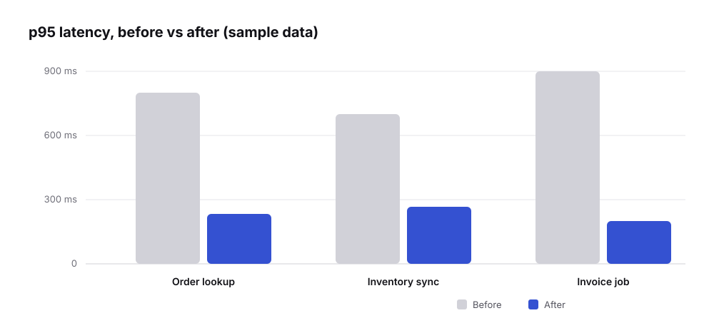
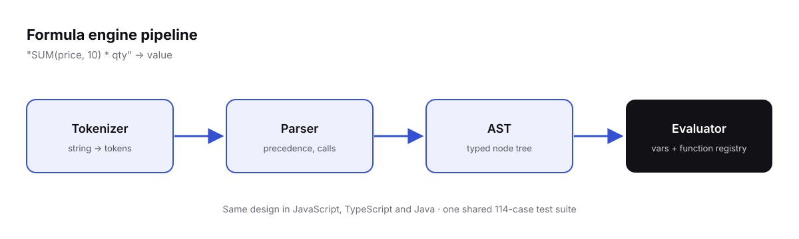

> [!NOTE]
> **Sample post.** This is a reference for every formatting feature. It's marked `"sample": true` in `data/posts.json`, so it only shows in preview mode — delete it whenever you like.

## Headings and the table of contents

Use `##` for sections and `###` for sub-sections. Each one gets a link anchor (hover a heading and click `#`) and appears in the **On this page** sidebar on wide screens. Don't repeat the post title as a heading — it comes from `posts.json`.

### A sub-section

Sub-sections are indented in the table of contents.

## Text formatting

Plain paragraphs, **bold**, *italic*, ~~strikethrough~~, `inline code`, and keyboard keys like <kbd>Ctrl</kbd> + <kbd>K</kbd>.

Links to [other pages on this site](blog.html), to [a specific write-up](work.html?slug=saga-orchestrator), and to [external sites](https://kafka.apache.org/documentation/) — external links open in a new tab automatically.

## Callouts

> [!NOTE]
> Useful information that readers should know, even when skimming.

> [!TIP]
> Helpful advice for doing things better or more easily.

> [!IMPORTANT]
> Key information readers need to achieve their goal.

> [!WARNING]
> Urgent info that needs immediate attention to avoid problems.

> [!CAUTION]
> Advises about risks or negative outcomes of certain actions.

A plain quote still works too:

> Make it work, make it right, make it fast. — Kent Beck

## Lists

1. Ordered lists
2. With nested items
   - like this one
   - and this one
3. Back to the top level

- Unordered list item
- Another item with `code`

Task lists:

- [x] Write the outline
- [x] Add a diagram
- [ ] Publish

## Code blocks

Add a language after the opening fence for syntax highlighting. Hover a block to copy it.

```java
@KafkaListener(topics = "orders.cancelled", groupId = "inventory-recovery")
public void onOrderCancelled(OrderCancelled event) {
    if (processed.exists(event.id())) {
        return; // already handled — safe to skip on redelivery
    }
    inventory.release(event.orderId(), event.items());
    processed.mark(event.id());
}
```

```typescript
type Token = { kind: "number" | "ident" | "op"; value: string };

export function tokenize(input: string): Token[] {
  const tokens: Token[] = [];
  for (const match of input.matchAll(/\d+(\.\d+)?|[A-Za-z_]\w*|[-+*/(),]/g)) {
    const value = match[0];
    const kind = /^\d/.test(value) ? "number" : /^\w/.test(value) ? "ident" : "op";
    tokens.push({ kind, value });
  }
  return tokens;
}
```

```sql
SELECT order_id, COUNT(*) AS barcodes
FROM order_barcodes
GROUP BY order_id
HAVING COUNT(*) > 1;
```

```yaml
spring:
  kafka:
    consumer:
      enable-auto-commit: false
      max-poll-records: 200
```

```bash
kafka-consumer-groups --bootstrap-server localhost:9092 \
  --describe --group inventory-recovery
```

```json
{ "orderId": "CL-482917", "status": "CANCELLED", "items": 2 }
```

Use `text` for diagrams and plain output — no highlighting, no label:

```text
Producer ──► orders.cancelled ──► Consumer ──► Inventory DB
                                     │
                                     └──► DLQ (after 3 retries)
```

## Tables

| Approach | Ordering | Complexity | Good for |
| --- | --- | --- | --- |
| Choreography | Per entity | Low | Few services, simple flows |
| Orchestration | Global | Medium | Multi-step flows with rollback |
| 2PC | Strict | High | Rarely worth it in microservices |

Wide tables scroll sideways on phones instead of breaking the layout.

## Images

Put images in `content/images/` and reference them relative to the Markdown file — the same path works in VS Code's Markdown preview:

```text

```

An image with a caption (the text in quotes). **Click it to view full-size:**


A PNG screenshot works the same way:

 are supported too")

An image without a caption:



## Collapsible sections

<details>
<summary>Click to expand the full stack trace</summary>

```text
org.apache.kafka.clients.consumer.CommitFailedException:
  Commit cannot be completed since the group has already rebalanced
    at ConsumerCoordinator.sendOffsetCommitRequest(ConsumerCoordinator.java:1109)
```

</details>

## Horizontal rule

Use `---` on its own line to separate parts of a long post.

---

That's everything. Copy `content/_templates/post.md` to start a real post.
