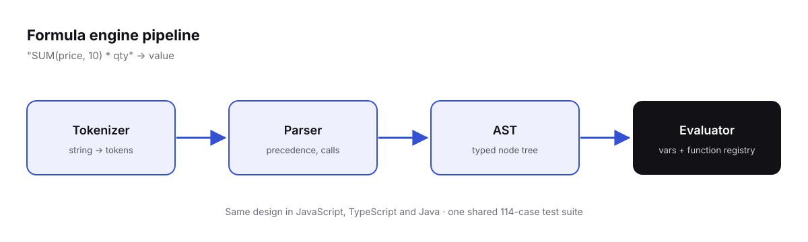

## Overview

A spreadsheet-style formula engine that takes an expression string, turns it into an abstract syntax tree, and evaluates that tree against named variables and a library of built-in functions.

I built the whole pipeline by hand — no parser generators, no expression libraries — and then ported the exact same design to **JavaScript**, **TypeScript** and **Java**.

## Why I built it

I wanted to properly understand how formula engines work under the hood instead of reaching for a library. Building it end-to-end forced me to make every decision myself: how to tokenize, how to handle operator precedence, how errors should surface, and how functions plug into the evaluator.

## Architecture

The engine is a classic four-stage pipeline:



Here is how one expression flows through it:

```text
"SUM(price, 10) * qty"            ← input expression (illustrative)
        │
        ▼
   Tokenizer   →  [IDENT SUM] [LPAREN] [IDENT price] [COMMA] [NUMBER 10] [RPAREN] [STAR] [IDENT qty]
        │
        ▼
     Parser    →  BinaryOp(*)
                    ├── Call(SUM, [Var(price), Num(10)])
                    └── Var(qty)
        │
        ▼
   Evaluator   →  walks the AST, resolves variables, dispatches function calls
        │
        ▼
     Result
```

1. **Tokenizer** — scans the raw string into typed tokens.
2. **Parser** — builds an AST that encodes precedence and associativity.
3. **AST** — a small set of node types: literals, variables, unary/binary operators and function calls.
4. **Evaluator** — recursively evaluates nodes against a variable context and a function registry.

## Built-in function library

Functions are grouped into categories and registered with the evaluator, so adding a new one doesn't touch the parser:

| Category | Purpose |
| --- | --- |
| Math | Arithmetic and numeric helpers |
| Text | String manipulation |
| Logical | Boolean logic and comparisons |
| Lookup | Finding values in collections |
| Control | Conditional flow |
| Date | Date construction and arithmetic |

## Three languages, one test suite

Once the JavaScript version was solid, I ported the same architecture to TypeScript and then Java. The important part wasn't the port — it was mirroring a **114-case test suite** across all three implementations, so I could verify that the *behaviour* actually matched, not just the API shape.

That suite caught the subtle differences that matter in an engine like this: number handling, string comparison semantics and error propagation.

## What I learned

<!-- TODO: add 3–4 concrete lessons, e.g. precedence-climbing vs. recursive descent, error recovery, numeric edge cases between JS and Java. -->

- Writing the parser by hand makes precedence and associativity rules concrete in a way reading about them never did.
- A shared, language-agnostic test suite is the real contract between implementations.
