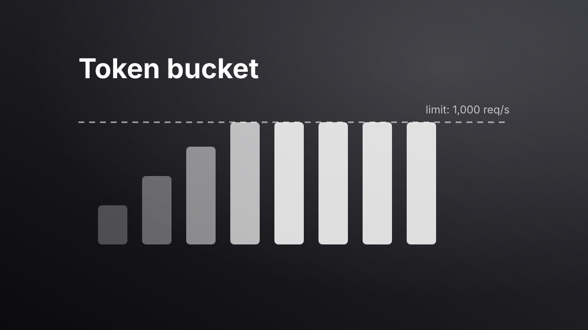

> [!NOTE]
> **Sample case study.** This whole project is placeholder content (`"sample": true` in `data/projects.json`) to show a case study with a cover image, source and demo buttons. Delete or replace it.

## Overview

A rate limiter that enforces **N requests per second per API key** across every node of a horizontally scaled API, adding under 2 ms of latency per request.



## Problem

Each API node kept its own in-memory counter, so a client spread across 8 nodes effectively got **8× its limit**. Abuse from a single key could still overload downstream services.

## Constraints

- Shared state across nodes, but no new infrastructure beyond the existing Redis cluster
- p99 overhead under 2 ms
- Must **fail open** — a limiter outage must not take the API down

## Approach & architecture

```text
Client ──► API node ──► Redis (Lua: refill + take token, atomically)
              │                 │
              │          unreachable?
              ▼                 ▼
           allowed /     local in-memory bucket (fallback) + alert
           429 + Retry-After
```

1. **Token bucket** per API key, stored as a Redis hash (`tokens`, `ts`).
2. **Lua script** makes refill-and-take atomic, so concurrent nodes can't double-spend tokens.
3. **Fallback** to a per-node bucket at `limit / nodes` when Redis times out.

```java
public Decision check(String apiKey) {
    try {
        long ok = redis.eval(TOKEN_BUCKET, List.of("rl:" + apiKey), args(apiKey));
        return ok == 1 ? Decision.ALLOW : Decision.deny(retryAfter(apiKey));
    } catch (RedisException e) {
        metrics.increment("ratelimit.fallback");
        return localBuckets.get(apiKey).tryTake() ? Decision.ALLOW : Decision.deny(1);
    }
}
```

## Results

| Metric | Before | After |
| --- | --- | --- |
| Effective limit per key | 8× configured | 1× configured |
| p99 overhead | — | 1.4 ms |
| Behaviour when Redis is down | n/a | degrades to per-node limits |

## What I'd do differently

Start with the sliding-window counter for simplicity, and only move to token bucket when bursts matter.
