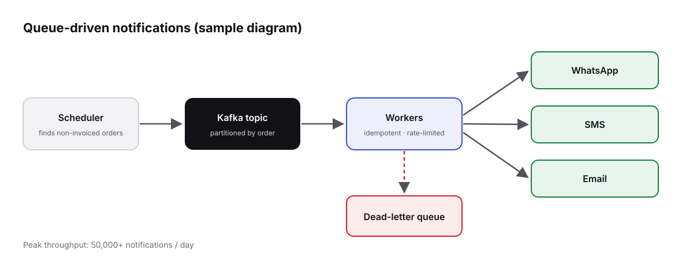

> [!NOTE]
> **Sample write-up.** Placeholder text showing how a work deep-dive looks. Replace it with the real story.

## Context

Orders that weren't invoiced on time needed reminders to stores and customers across **WhatsApp, SMS and email**. The existing cron job sent everything in one burst, hit provider rate limits, and silently dropped failures.

## Architecture



- A **scheduler** finds non-invoiced orders and publishes one event per reminder.
- A **Kafka topic** partitioned by order ID keeps reminders for an order in sequence.
- **Workers** are idempotent and rate-limited per provider.
- Failures retry with backoff, then land in a **dead-letter queue** for inspection.

```javascript
async function handle(reminder) {
  const key = `${reminder.orderId}:${reminder.template}:${reminder.channel}`;
  if (await sent.has(key)) return;               // redelivery — skip

  await limiter[reminder.channel].take();        // respect provider limits
  await providers[reminder.channel].send(reminder);
  await sent.add(key, { ttl: "7d" });
}
```

## Results

- Peak throughput above **50,000 notifications/day**
- No more provider rate-limit bans
- Every failure is visible in the DLQ instead of lost

## What I'd do differently

Add per-template delivery dashboards from day one — product teams asked for them within a week.
