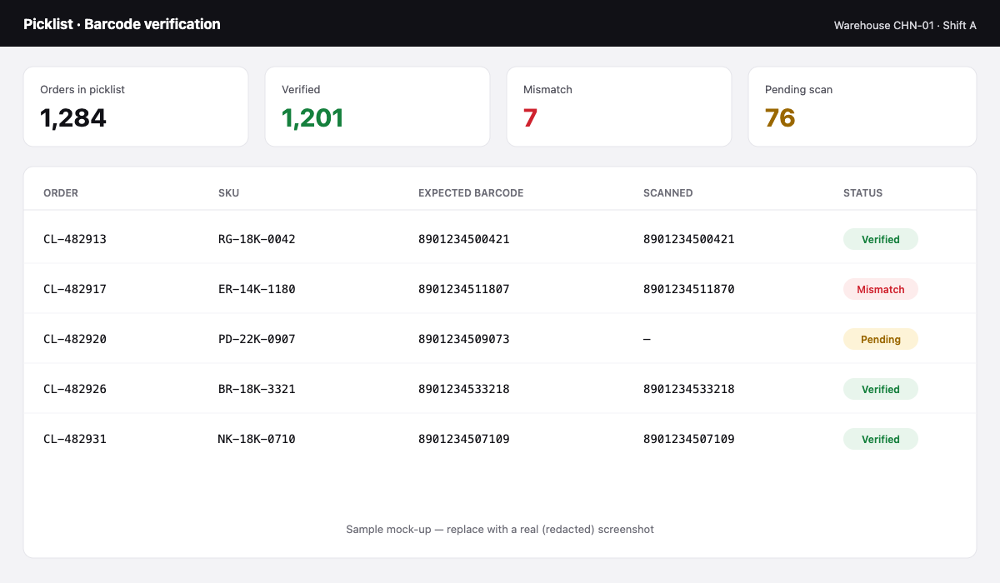

> [!NOTE]
> **Sample write-up.** Placeholder text and a mock-up screenshot. Replace with the real story and a redacted screenshot.

## Context

Before invoicing, warehouse staff verified that the item picked matched the order by scanning its barcode. Mismatches were caught late — sometimes after the parcel had shipped.

## What I built

A **React.js dashboard** that shows each order in the picklist, the expected barcode, the scanned one, and a clear status.

- Instant feedback on scan: green for match, red for mismatch
- Summary counters so shift leads see progress at a glance
- Mismatches block invoicing until resolved

## Results

- Handles **20% of all orders** before invoicing
- Mismatches caught at the warehouse, not by customers
