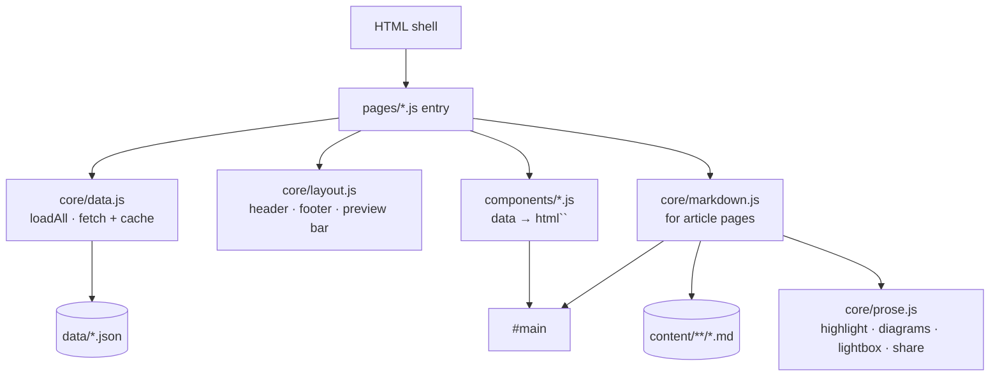

# Architecture

How the site is put together, and why. Read this first if you're new to the codebase.

## Principles

1. **No build step.** Plain HTML, CSS and native ES modules. Any static host serves the folder as-is.
2. **Content is data.** Structured content lives in `data/*.json`, long-form content in `content/**/*.md`. Adding content never requires touching JavaScript.
3. **Safe by default.** All HTML is produced through the `html` tagged template, which escapes every value.
4. **Empty means hidden.** A section or link with no data renders nothing — never a "coming soon" placeholder on the live site.
5. **Relative paths everywhere.** Never use a leading `/`, so the site works on any static host or sub-path (it's deployed on Netlify).

## Folder map

```
index.html  blog.html  post.html  work.html  project.html  404.html   ← page shells
README.md  AGENTS.md
assets/          code only
  css/           tokens → base → components → pages (loaded in that order)
  js/core/       framework-free building blocks (data, templating, markdown, layout…)
  js/components/ one file per home-page section / shared UI piece
  js/pages/      one entry module per HTML page
  vendor/        third-party libs, vendored (no CDN at runtime)
  favicon.svg
content/         everything you write or upload
  posts/         article bodies          (slug = file name)
  work/          one write-up per experience bullet
  projects/      case-study bodies
  templates/     starting points for new content
  images/        profile.jpg · covers/ · diagrams/ · screenshots/
  files/         downloadable files (résumé PDF)
data/            JSON content (one file per concern)
scripts/         Node helpers: serve (dev server), new-post, check-content
docs/            this documentation
```

## Request flow

Every HTML file is a thin shell: `<head>` (meta, theme pre-paint script, CSS), empty `<header id="site-header">`, `<main id="main">`, `<footer id="site-footer">`, and one `<script type="module">`.



| Page | Entry module | `<body>` attributes | Loads |
| --- | --- | --- | --- |
| `index.html` | `pages/home.js` | `data-page="home"` | all data files |
| `blog.html` | `pages/blog.js` | `data-page="blog"` | profile, posts, experience, projects, skills |
| `post.html?slug=` | `pages/article.js` | `data-page="post" data-kind="post"` | + `content/posts/<slug>.md` |
| `work.html?slug=` | `pages/article.js` | `data-page="work" data-kind="work"` | + `content/work/<slug>.md` |
| `project.html?slug=` | `pages/article.js` | `data-page="project" data-kind="project"` | + `content/projects/<slug>.md` |
| `404.html` | none (static) | — | — |

## Core modules (`assets/js/core/`)

| Module | Responsibility | Key exports |
| --- | --- | --- |
| `dom.js` | Safe templating + DOM helpers | `html`, `raw`, `esc`, `inline` (`**bold**`), `plain`, `safeUrl`, `externalAttrs`, `mount`, `$`, `$$`, `debounce`, `setMeta` |
| `data.js` | Load JSON/Markdown, preview mode | `load`, `loadAll`, `loadContent`, `isValidSlug`, `isPreview`, `isLocal`, `visible`, `visiblePosts`, `tagCounts`, `currentRole` |
| `library.js` | Merge all readable documents into one list; skills → evidence | `buildLibrary`, `workDocs`, `DOC_TYPES`, `docHref`, `workHref`, `typeCounts`, `skillList`, `skillSlug`, `skillEvidence` |
| `search.js` | In-memory search + match highlighting | `searchDocs`, `highlight`, `tokenize` |
| `markdown.js` | Markdown → HTML (marked) with site extras | `renderMarkdown(src, { baseDir })`, `isEmptyMarkdown` |
| `prose.js` | Enhancements on rendered Markdown | `highlightCode`, `renderDiagrams`, `initCodeCopy`, `initLightbox`, `initProgress`, `initShare` |
| `layout.js` | Header, mobile menu, footer, preview bar, scroll-spy, error screen | `mountLayout({ page, profile })`, `renderFatal` |
| `theme.js` | Light/dark toggle; fires `themechange` on `document` | `initThemeToggle`, `currentTheme` |
| `format.js` | Dates, durations, slugs | `formatMonth`, `formatDate`, `formatRange`, `duration`, `readingTime`, `slugify`, `initials` |
| `icons.js` | Inline Lucide SVG icons | `icon(name, className)`, `PROOF_ICONS` |

## Components (`assets/js/components/`)

A **section component** takes the page context and returns a *descriptor* — or `null` to hide itself:

```js
export function Skills({ skills = [] }) {
  if (!skills.length) return null;
  return { id: "skills", title: "Skills & tools", lead: "…", action: optionalHtml, body: html`…` };
}
```

`pages/home.js` lists sections in order (`SECTIONS`), drops `null`s and wraps each in `Section()` (section.js). Set `bare: true` to render without the standard heading (Contact does this).

Behaviour is added after mounting by `init*` functions using **event delegation** on a root element (e.g. `initContact(main)`), never inline `onclick`.

| File | Renders |
| --- | --- |
| `hero.js` | name, role, headline, CTAs, socials, photo (+ `initHeroPhoto` fallback to initials), metrics |
| `about.js` | bio + Recognition (achievements) + Education cards |
| `experience.js` | companies → roles timeline; every highlight links to `work.html?slug=` |
| `projects.js` | project cards (`ProjectCard`), generated cover when no image |
| `skills.js` | skill groups; each skill links to `blog.html?skill=` with an evidence count |
| `testimonials.js` | Appreciation quotes |
| `posts.js` | `DocItem` (one row in any document list), `StatusBadge`, home "Latest writing" |
| `contact.js` | CTA panel + copy-email (`initContact`) |
| `section.js` | standard section shell |

## The library: one model for every document

`buildLibrary()` normalises three sources into one shape so the Blog page can search across all of them:

```js
{ type: "article" | "work" | "project", slug, title, date, excerpt, tags, context?, stack?, draft, sample, href }
```

| Type | Index file | Body | Page |
| --- | --- | --- | --- |
| `article` | `data/posts.json` | `content/posts/<slug>.md` | `post.html` |
| `work` | highlights in `data/experience.json` | `content/work/<slug>.md` | `work.html` |
| `project` | `data/projects.json` where `caseStudy: true` | `content/projects/<slug>.md` | `project.html` |

Work documents sort by role end date (or start date for the current role).

## Preview mode (drafts & samples)

`isPreview()` in `data.js`:

- **on by default on `localhost` / `127.0.0.1`**, off on any other host;
- `?preview=1` / `?preview=0` overrides it for the browser tab (stored in `sessionStorage`).

Anything with `"draft": true` or `"sample": true` is only shown in preview. Use `visible(list)` for any data list and `buildLibrary()` for documents — never filter by hand. A work page whose bullet is a draft (or whose Markdown is empty) shows the "write-up in progress" card and sets `robots: noindex`.

## Markdown pipeline

`renderMarkdown(source, { baseDir })` uses **marked v12** (vendored) with a custom renderer:

- `##`/`###` headings get ids + `#` anchors and feed the table of contents (shown when ≥ 3 headings);
- relative image/link paths resolve against the `.md` file's folder (`baseDir`), matching VS Code's preview;
- `` → `<figure>` with caption;
- `> [!NOTE|TIP|IMPORTANT|WARNING|CAUTION]` → callouts;
- fenced code → copy button + language label; ` ```mermaid ` → diagram placeholder;
- tables wrapped for horizontal scroll.

Then `prose.js` enhances the result: highlight.js core + only the grammars used (lazy `import()`), Mermaid + ZenUML plugin (lazy `<script>` via `loadVendor()`, re-renders on `themechange`), image lightbox (`<dialog>`), reading progress, share buttons. Raw HTML in Markdown passes through — content is first-party.

> marked v12 uses the **positional** renderer API (`heading(text, level)`, `code(code, lang, escaped)`…). v13+ switched to token objects — update `markdown.js` if you upgrade.

## Vendored libraries (`assets/vendor/`)

| Library | Version | Loaded |
| --- | --- | --- |
| marked | 12.0.2 (`marked.esm.js`) | on article pages |
| highlight.js | 11.9.0 (`hljs/core.min.js` + `hljs/languages/*.min.js`) | only when a code block has a known language |
| Mermaid | 12.3.0 (`mermaid.min.js`, ~5.5 MB, sets `window.mermaid`; one-line local patch for Safari, marked at the top of the file) | only when a page has a ` ```mermaid ` block |
| ZenUML plugin | @mermaid-js/mermaid-zenuml 1.0.1 (`mermaid-zenuml.min.js`, ~3.3 MB, sets `window["mermaid-zenuml"]`) | only when a diagram starts with `zenuml`; registered via `mermaid.registerExternalDiagrams` |

## Known trade-offs

- **SEO:** content renders client-side. Fine for a portfolio; migrate to Astro/Eleventy if blog traffic matters — `data/` and `content/` port over unchanged.
- **Search:** in-memory over title/excerpt/tags/context; swap `search.js` for Pagefind/MiniSearch past ~1,000 documents.
- **`file://` doesn't work** (fetch + modules). Always use a local server; `renderFatal` explains this if someone tries.
