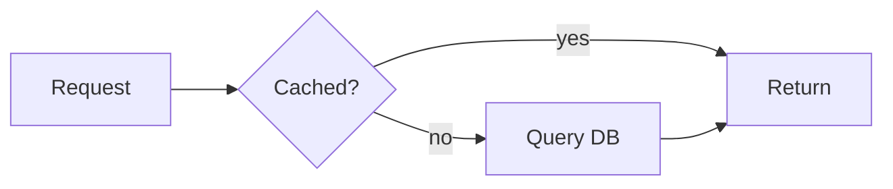

# Content guide

Everything you need to add or change content. No code changes needed for any of this.

## Golden rules

- **Slugs** are `lowercase-words-with-dashes`. The Markdown file name must equal the slug.
- **Dates** are `YYYY-MM-DD` (posts) or `YYYY-MM` (jobs, education).
- **Drafts:** `"draft": true` → only visible in preview (localhost). Flip to `false` to publish.
- **Samples:** `"sample": true` marks placeholder content — also preview-only. Delete or replace before going live.
- **Empty = hidden.** An empty URL, list or file hides that thing; no placeholders appear live.
- After any change run **`node scripts/check-content.mjs`** — it catches missing files, broken image paths, bad slugs/dates and lists what's still draft/sample.

---

## ✍️ Writing a new blog post (the checklist)

**1. Create it (one command):**

```bash
node scripts/new-post.mjs "Your post title" --tags kafka,java --excerpt "One-sentence summary"
```

This creates `content/posts/<slug>.md` (from the template) **and** adds the entry to the top of `data/posts.json` with today's date and `"draft": true`. Use `--slug my-slug` to choose the slug.

> Without Node: copy `content/templates/post.md` to `content/posts/<slug>.md` and add this to the **top** of `data/posts.json`:
> ```json
> { "slug": "<slug>", "title": "…", "date": "YYYY-MM-DD", "excerpt": "…", "tags": ["…"], "draft": true }
> ```

**2. Write** in `content/posts/<slug>.md`:
- Don't repeat the title as a heading — it comes from `posts.json`.
- Use `##` for sections, `###` for sub-sections (they build the table of contents).
- Images: save to `content/images/`, reference as ``.
- Diagrams: ` ```mermaid ` blocks (see below).

**3. Preview:** `node scripts/serve.mjs` → `http://localhost:8000/post.html?slug=<slug>`

**4. Check:** `node scripts/check-content.mjs` → must say **✓ No errors**.

**5. Publish:** set `"draft": false` in `data/posts.json`, then commit / upload.

**Files touched for a new post — always exactly these:**

| File | Change |
| --- | --- |
| `data/posts.json` | new entry at the top |
| `content/posts/<slug>.md` | the post |
| `content/images/*` | only if the post has images |

Nothing else. The home page "Latest writing", the Blog list, search, tags, prev/next links and the nav all update automatically.

---

## Work write-ups (one per experience bullet)

Every bullet in `data/experience.json` has a `slug` and links to `work.html?slug=<slug>`.

1. Open `content/work/<slug>.md` — it contains a commented outline (invisible on the site).
2. Write the story. Until the file has real text, the page shows "write-up in progress".
3. Set `"draft": false` on that highlight in `data/experience.json` → the full write-up goes live and appears on the Blog under **Work**.

Highlight fields (comments are explanations — don't paste them into JSON):

```jsonc
{
  "slug": "saga-orchestrator",
  "title": "A reusable Saga orchestrator",          // page title + blog title
  "text": "Built a reusable **Saga Orchestrator** …", // the bullet; **bold** allowed
  "tags": ["saga-pattern", "microservices"],
  "draft": true
}
```

**New bullet:** add a highlight with a new slug, then create `content/work/<slug>.md` (copy any stub, or leave it missing — the page still works).

## Jobs & promotions — `data/experience.json`

Companies → `roles` (newest first). `"end": null` = current role. Durations, "Present" and the timeline dot are automatic. Optional `"url"` (company link) and `"logo"` (image path; otherwise a monogram).

## Projects — `data/projects.json`

```jsonc
{
  "slug": "formula-engine",
  "title": "Formula Calculation Engine",
  "summary": "Card text, 1–2 sentences.",
  "context": "Personal project",
  "date": "2025-06-01",                        // optional, used for sorting on the Blog
  "cover": "content/images/covers/formula-engine.svg", // optional; empty = generated cover
  "stack": ["JavaScript", "TypeScript"],
  "tags": ["parsing"],
  "links": { "source": "https://github.com/…", "demo": "" },  // empty = hidden
  "featured": true,                            // show on the home page
  "caseStudy": true,                           // needs content/projects/<slug>.md
  "workDoc": "cl-connect"                      // alternative: link to a work write-up
}
```

Case study body: copy `content/templates/project.md` → `content/projects/<slug>.md`.

## Skills & proof — `data/skills.json`

Every skill links to `blog.html?skill=<skill>`, which shows its **proof**:

```jsonc
{
  "name": "Kafka",
  "match": ["kafka", "event-driven"],     // optional: words that count as "uses this skill" (whole words)
  "proof": [
    { "label": "Kafka consumer demo", "url": "https://github.com/…", "type": "github" }
  ]
}
```

Proof `type`: `github`, `demo`, `article`, `certificate`, `video`, `link`. Project source/demo links and any write-up that mentions the skill are added automatically. The small number on a skill tag = amount of proof.

## Appreciation — `data/testimonials.json`

```json
{ "quote": "…", "name": "…", "role": "…", "company": "…", "relationship": "Managed me",
  "photo": "content/images/name.jpg", "url": "https://linkedin.com/…" }
```

Empty list → section hidden.

## Profile — `data/profile.json`

Name, headline (`**bold**` allowed), bio paragraphs, location, availability line, email, phone, WhatsApp (digits with country code), résumé path (`content/files/…`), photo (`content/images/profile.jpg`), socials (`icon`: `github` | `linkedin` | `mail`), and the four hero **metrics**.

Other files: `education.json`, `achievements.json` (About section cards).

---

## Markdown features

The sample post `content/posts/writing-guide.md` demonstrates everything. Summary:

| Feature | Syntax |
| --- | --- |
| Section / sub-section / small heading | `##` / `###` (both in the table of contents) / `####` (not in it) |
| Bold, italic, both, strikethrough | `**b**`, `*i*`, `***bi***`, `~~s~~` |
| Inline code | `` `code` `` (use double backticks to include a backtick) |
| Highlight, keys, sub/superscript, abbreviation, small | `<mark>`, `<kbd>`, `<sub>`/`<sup>`, `<abbr title="…">`, `<small>` |
| Line break inside a paragraph | end the line with a backslash, or use `<br>` |
| Escape a Markdown character | put a backslash before it, e.g. `\*`, `\#`, `\[` |
| Links | `[text](blog.html)`, `[text](work.html?slug=x)`, `[text](#section-id)`, `<https://…>`, bare URLs, `<me@mail.com>`, `[text](url "tooltip")`, reference-style `[text][id]` + `[id]: url` |
| Lists | `-` / `1.` (any start number), nest by indenting, paragraphs/code inside items (indent 3 spaces) |
| Task list | `- [x] done` / `- [ ] todo` |
| Definition list | `<dl><dt>Term</dt><dd>Meaning</dd></dl>` |
| Quote | `>`; nest with `> >`; can hold lists and code |
| Callout | `> [!NOTE]` · `[!TIP]` · `[!IMPORTANT]` · `[!WARNING]` · `[!CAUTION]` (multi-paragraph, lists, code OK) |
| Code + highlighting | ` ```java ` … java, js/ts, python, sql, yaml, json, bash, diff, go, kotlin, ruby, graphql, lua, xml/html |
| Plain block / ASCII diagram | ` ```text ` or no language |
| Diagram | ` ```mermaid ` — 35 types, see below |
| Table | GitHub tables; align with `:---` / `:---:` / `---:`; bold, code, links and `<br>` inside cells; escape a pipe inside a cell with a backslash; wide tables scroll |
| Image with caption | `` — click to zoom |
| Linked image | `[](page.html)` — click follows the link |
| Sized image | `` (HTML paths are from the site root) |
| Images side by side | `<div class="image-row">   </div>` (stack on phones) |
| Embed / video | an `<iframe …>` on its own line (responsive 16:9) · `<video src="…" controls>` |
| Collapsible | `<details><summary>Title</summary>` + blank line + Markdown + blank line + `</details>` |
| Hidden note | `<!-- not rendered -->` |
| Not supported | footnotes, LaTeX maths, emoji shortcodes, coloured text — the guide's "Not supported" table lists alternatives |

Every row is demonstrated in `content/posts/writing-guide.md` — open it next to the rendered page.

### Mermaid example

````markdown

````

Diagrams use greys in light mode and switch automatically in dark mode. A syntax error shows the message and the source instead of breaking the page. Draft diagrams at <https://mermaid.live>.

**Supported types** (Mermaid 12.3.0) — the first line of the block picks the type. A working example of every one is in `content/posts/writing-guide.md` → "Diagrams (Mermaid)"; copy from there.

| Type | First line | Type | First line |
| --- | --- | --- | --- |
| Flowchart | `flowchart LR` | Quadrant | `quadrantChart` |
| Class | `classDiagram` | Radar | `radar-beta` |
| Sequence | `sequenceDiagram` | Railroad (ABNF) | `railroad-abnf-beta` |
| Entity relationship | `erDiagram` | Railroad (EBNF) | `railroad-ebnf-beta` |
| State | `stateDiagram-v2` | Railroad (IR) | `railroad-beta` |
| Mindmap | `mindmap` | Railroad (PEG) | `railroad-peg-beta` |
| Architecture | `architecture-beta` | Requirement | `requirementDiagram` |
| Block | `block` | Sankey | `sankey` |
| C4 | `C4Context` (also `C4Container`, `C4Component`, `C4Dynamic`, `C4Deployment`) | Swimlane | `swimlane-beta LR` |
| Cynefin | `cynefin-beta` | Timeline | `timeline` |
| Event modeling | `eventmodeling` | Tree view | `treeView-beta` |
| Gantt | `gantt` | Treemap | `treemap-beta` |
| Git | `gitGraph` | Use case | `usecase-beta` |
| Ishikawa (fishbone) | `ishikawa-beta` | User journey | `journey` |
| Kanban | `kanban` | Venn | `venn-beta` |
| Packet | `packet` | Wardley map | `wardley-beta` |
| Pie | `pie` | XY chart | `xychart` |
| | | ZenUML | `zenuml` (loads a plugin automatically) |

`-beta` types are new in Mermaid; their syntax may change in future versions. Full syntax per type: <https://mermaid.js.org/intro/>. Diagrams need a modern browser (Safari 17.4+); older browsers show the diagram source instead.

## Images

- Location: **all images live in `content/images/`**, grouped by purpose:
  - `content/images/profile.jpg` — your photo
  - `content/images/covers/` — project card covers (name them after the project slug)
  - `content/images/diagrams/` — architecture drawings, charts
  - `content/images/screenshots/` — UI screenshots (redact anything confidential)
  - add a folder per post if a post has many images, e.g. `content/images/how-this-site-works/`
- Downloadable files (résumé PDF) live in `content/files/`.
- From Markdown: path relative to the `.md` file → `../images/diagrams/x.svg`.
- From JSON or HTML: path from the site root → `content/images/covers/x.svg`.
- Formats: SVG, PNG, JPG, WebP. Keep photos under ~300 KB; redact anything confidential in work screenshots.

## Before going live

```bash
node scripts/check-content.mjs
```

The "Not live yet" list shows every remaining sample/draft. Replace samples (social links, testimonials, sample posts/project, skill proof links, sample work write-ups and diagrams), then open the site with `?preview=0` to see exactly what visitors see.
